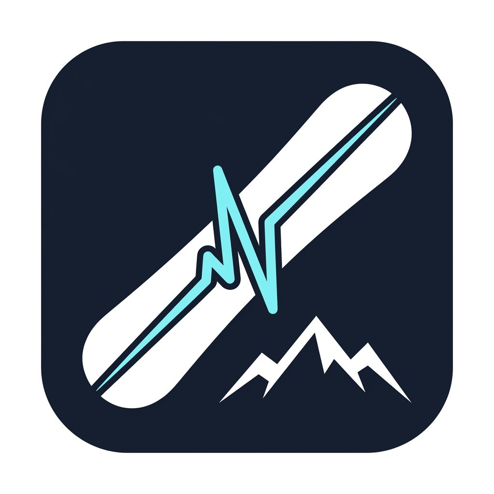

# SnowPulse - スノーボード滑走分析＆スマートコーチング Android アプリ

<p align="center">
  
</p>

<p align="center">
  
  
  
  
</p>

**SnowPulse（スノープルス）** は、スノーボーダーのための次世代滑走トラッキング＆リアルタイムコーチング Android アプリケーションです。
既存アプリ（yukiyama等）のGPS距離・速度計測に加え、スマートフォン内蔵センサーを用いた**「エッジ角（傾斜角）推定」「トリック（オーリー/スピン）自動判定」「リアルタイム音声アナウンス」「オフライン雪質振動解析」**を実現しています。

---

## 📱 主要機能

- **滑走 / リフト自動判定ステートマシン (`StateDetectionEngine`)**:
  - GPS速度と高度変化率から、画面操作なしで「滑走開始」「リフト搭乗」「一時停止」を完全自動判別。
- **3Dモーション＆エッジ角解析 (`MotionAnalysisEngine`)**:
  - 直進滑走時の加速度からポケット内の端末の傾きを自動キャリブレーション。
  - ボードの角付け（エッジ角）をリアルタイムゲージ表示。
  - 無重力（抜重）〜着地衝撃の物理モデルからオーリー滞空時間・ジャンプ高、ジャイロ積分から 180 / 360 スピンを自動検知。
- **音声スマートコーチング (`AudioCoachEngine`)**:
  - Bluetoothイヤホン経由で滑走サマリーやトリック成功を音声アナウンス（音楽再生中の Audio Ducking 対応）。
- **いつでも変更可能なギア・収納位置設定 (`SettingsScreen`)**:
  - スタンス（Regular/Goofy）やスマホの収納位置（パンツ前足/後足/胸ポケ/リュック）をいつでも何度でも変更可能。
- **雪上ハイコントラスト ＆ グローブ対応UI**:
  - 強い雪上反射下でも見やすいダーク＆ネオンテーマ、72sp級の巨大スピードメーター、押し間違いのないビッグボタン設計。
- **机上検証用モックデータ再生システム (`MockScenarioReplayer`)**:
  - ゲレンデに行かなくても、CSVシナリオを再生して全機能を机上でシミュレート可能。

---

## 🏗 システムアーキテクチャ

Clean Architecture + MVVM パターンを採用しています。

```
com.snowpulse.app/
├── data/
│   ├── model/Entities.kt          # Session, Run, GeoPoint, TrickEvent, Stance, PhonePlacement
│   └── local/
│       ├── AppDatabase.kt         # Room Database
│       ├── TrackingDao.kt         # DBアクセス用 DAO
│       └── PreferencesManager.kt  # スタンス・収納位置保存 (DataStore)
├── domain/
│   ├── engine/
│   │   ├── StateDetectionEngine.kt # 滑走/リフト自動判定
│   │   ├── MotionAnalysisEngine.kt # 姿勢補正・エッジ角・トリック解析
│   │   └── AudioCoachEngine.kt    # TTS音声フィードバック
│   └── mock/
│       └── MockScenarioReplayer.kt # CSVログ再生エンジン
├── service/
│   └── TrackingForegroundService.kt # 常駐バックグラウンド計測サービス
└── ui/
    ├── MainActivity.kt            # 画面遷移 & Google Play位置情報開示ダイアログ
    ├── theme/Theme.kt             # ネオンシアン/アンバーのハイコントラストテーマ
    └── screens/
        ├── DashboardScreen.kt     # ホーム画面（本日のサマリー・履歴一覧）
        ├── TrackingScreen.kt      # 滑走中画面（極大速度表示・エッジ角・ビッグボタン）
        ├── RunDetailScreen.kt     # ラン詳細・トリックレポート画面
        └── SettingsScreen.kt      # スタンス・スマホ収納位置設定画面
```

---

## 🚀 開発環境 & セットアップ手順

### 必要環境
- **Android Studio**: Iguana (2023.2.1) 以降 推奨
- **JDK**: Java 17
- **Android SDK**:
  - `compileSdk`: 34 (Android 14)
  - `minSdk`: 26 (Android 8.0 Oreo 以上)
  - `targetSdk`: 34

### プロジェクトのインポートとビルド
1. Android Studio を起動し、**「Open」** から `snowpulse-android` フォルダを選択。
2. Gradle Sync が完了するのを確認。
3. 実機またはエミュレータ（API 26以上）を選択して **Run (Shift + F10)** を実行。

---

## 🧪 単体テストの実行

### 1. Android Studio / Gradle からの実行
プロジェクトルートで以下のコマンドを実行します：
```bash
./gradlew test
```
- テストファイル: `app/src/test/java/com/snowpulse/app/domain/engine/EngineUnitTest.kt`

### 2. Python CLI テストランナーからの実行
ローカル環境でアルゴリズムを高速検証するためのテストスクリプトも同梱しています：
```bash
python3 run_algorithm_tests.py
```
- **検証項目**: 全18項目（滑走検知、リフト乗車判定、オーリー滞空時間、180スピン角度積分、プリセットCSVシナリオ通し検証）
- **テスト結果**: 18 / 18 Passed (合格率 100%)

---

## 📄 設計・仕様ドキュメント一覧

- [要件定義書](../snowboard_app_requirements.md)
- [基本設計・アーキテクチャ設計書](../architecture_design.md)
- [収納位置 & モック再生テスト仕様書](../hardware_and_testing_spec.md)
- [UI画面仕様書](../ui_wireframe_spec.md) / [インタラクティブワイヤーフレーム](../wireframe.html)
- [単体テスト結果レポート](../test_execution_report.md)
- [コードレビューレポート](../code_review_report.md)
- [雪山実地テスト手順書 (Playbook)](FIELD_TEST_PLAYBOOK.md)
