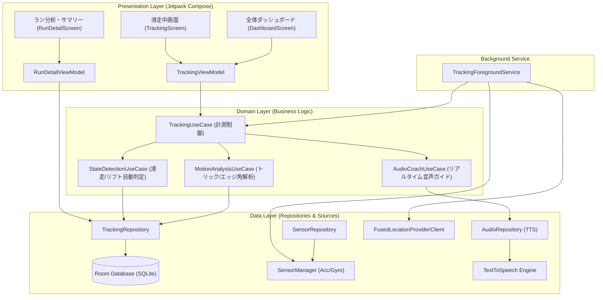
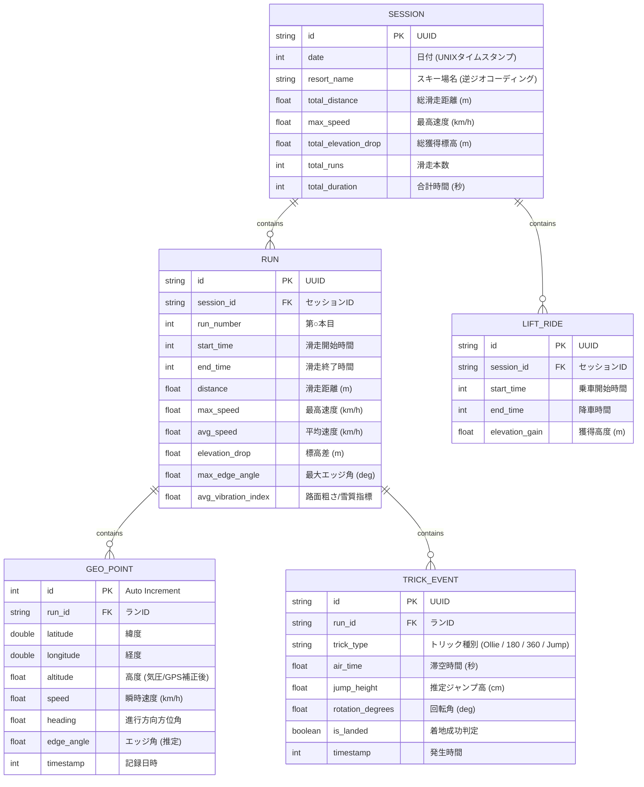
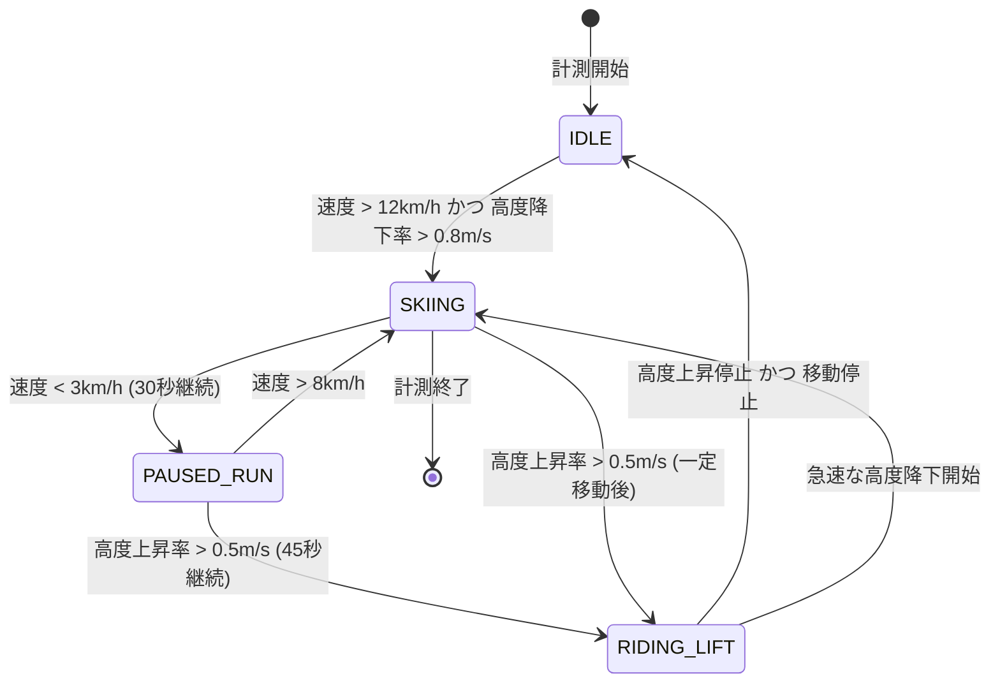
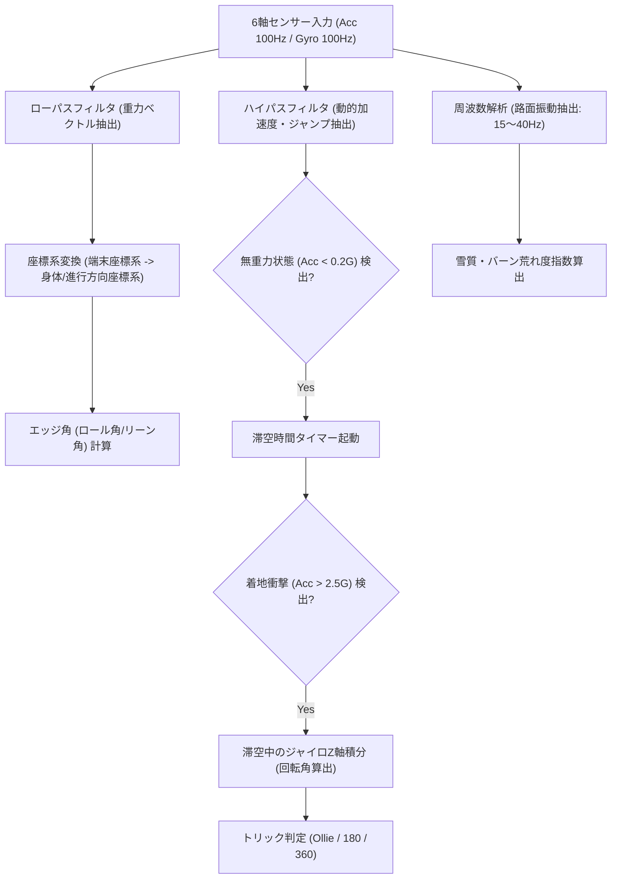

# スノーボードアプリ「SnowPulse」基本設計・アーキテクチャ設計書

## 1. 全体システムアーキテクチャ

Android推奨の**Clean Architecture + MVVM (Model-View-ViewModel)**パターンを採用し、センサーやGPSなどのハードウェア依存部分とドメインロジック（滑走・リフト判定、モーション解析）を疎結合に分離します。

---

## 2. データモデル設計 (Database Schema)

オフライン環境でもすべての滑走ログを永続化できるよう、**Room (SQLite)** を利用した階層型データ構造とします。

---

## 3. コアアルゴリズム設計

### 3.1 滑走 / リフト搭乗 自動判定ステートマシン
ゲレンデ上でユーザーが操作しなくても、ステートマシンにより「滑走」「リフト」「待機」を自動遷移します。

- **リフト搭乗確定時のフック**:
  - 直前の「滑走（RUN）」データを確定してRoom DBに保存。
  - **リアルタイム音声サマリーをトリガー**（「○本目終了。滑走距離 1.2km、最高速度 54km/h」をイヤホンに再生）。
  - リフト中は不要な高周波IMUサンプリングを自動停止し、バッテリー消費を半減。

---

### 3.2 3Dモーション＆エッジ角解析パイプライン

スマホはウェアのポケット（腿や胸）に入れられるため、**姿勢キャリブレーション（姿勢推定）**を行ってからターンやトリックを判定します。

1. **姿勢キャリブレーション**:
   - 重力加速度の方向からスマホの傾き姿勢（基準クォータニオン）を初期化・動的補正。
2. **ターン・エッジ角の算出**:
   - 進行方向に対する左右の傾斜角（Roll）を算出し、遠心加速度（Gフォース）と照合して真のエッジ角を推定。
3. **トリック判定**:
   - オーリー／ジャンプ: 抜重（落下による一時的な低G状態: $< 0.3G$）から着地衝撃（$> 2.0G$）までの時間を「滞空時間」として計測。
   - スピン: 滞空時間内の鉛直軸周りの角速度（Yaw）を積分し、回転角度（$180^\circ, 360^\circ$）を算出。

---

## 4. バックグラウンド＆省電力設計

ゲレンデの低温環境下でも、1日（約6〜7時間）連続動作させるための省電力アーキテクチャ。

1. **フォアグラウンドサービス (`TrackingForegroundService`)**:
   - Android OSによるプロセスキルの防止。
   - 通知バーに「現在の速度」「滑走本数」「一時停止/再開ボタン」を常時表示。
2. **動的センサーサンプリング制御**:
   - **滑走中 (SKIING)**:
     - GPS: 1Hz (高精度 `PRIORITY_HIGH_ACCURACY`)
     - IMU (加速度/ジャイロ): 50Hz〜100Hz
   - **リフト中 / 休憩中 (RIDING_LIFT / IDLE)**:
     - GPS: 0.1Hz〜0.2Hz（5〜10秒に1回）
     - IMU: **停止**（CPU負荷とバッテリー消費を大幅削減）
3. **バッチ書き込み**:
   - GPS座標やセンサーデータはメモリ上のリングバッファに蓄積し、数十件単位でRoom DBにバルクインサート（I/O負荷低減）。

---

## 5. 音声フィードバック（Text-to-Speech）設計

- **発話キューマネージャー (`AudioCoachManager`)**:
  - 音声案内が重複しないよう優先度付きキューで管理。
    1. **緊急/即時案内 (最高優先)**: 速度上限超過警告
    2. **イベント案内 (中優先)**: トリック成功通知（「Nice 360!」）
    3. **ラン終了サマリー (低優先)**: リフト乗車検知時の統計読み上げ
  - 音楽再生アプリ（Spotify等）と競合しないよう、`AudioFocusRequest`（Audio Ducking: 音声案内中だけ音楽の音量を一時的に下げる）を使用。
