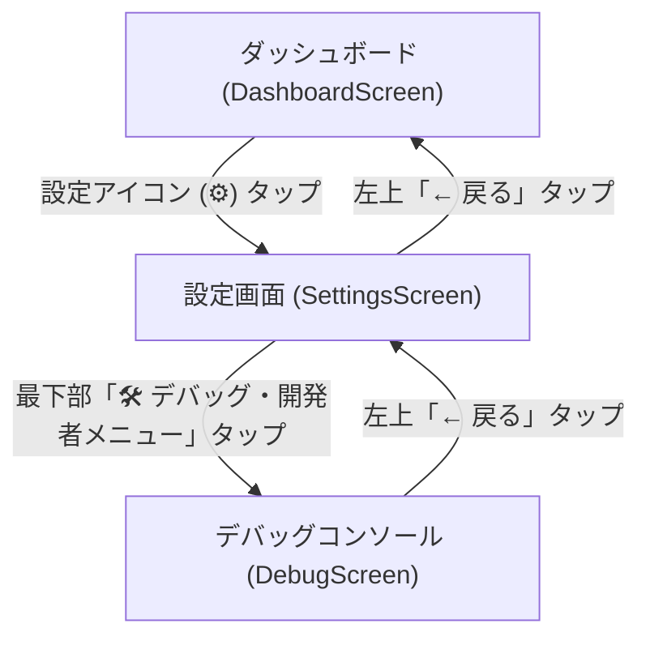

# SnowPulse デバッグ機能 要件定義書 (Debug Feature Requirements Specification)

- **プロジェクト名**: SnowPulse (AIスノーボード・スキー滑走計測アプリ)
- **対象プラットフォーム**: Android (Kotlin / Jetpack Compose / Room) & Webプロトタイプ
- **改定日**: 2026-10-04 (悲観的セルフレビュー & ログ確認機能追加版)
- **バージョン**: 2.0.0
- **作成者**: SnowPulse 開発チーム

---

## 1. 背景と目的

### 1.1 背景
SnowPulseは、GPS測位、6軸IMUセンサー、フォアグラウンドサービス、TTS音声コーチング、AI解析、Roomデータベースが複雑に連携するアプリです。
机上の理想論ではなく**「雪山現場での実機テスト・オフシーズンでの室内検証・過去に発生したバグの確実な再発防止」**を最優先課題とし、デバッグ機能を再設計しました。

### 1.2 目的
PCへのUSB接続やAndroid StudioのLogcatに依存せず、**スマートフォン実機単体で「状態再現」「境界値注入」「リアルタイムログ確認」「データ初期化」が完結するデバッグコンソール**を提供します。

---

## 2. 画面遷移フロー



- **アクセス経路**: [`SettingsScreen.kt`](file:///Users/sanada_a/repo/snowpulse-android/app/src/main/java/com/snowpulse/app/ui/screens/SettingsScreen.kt) の最下部に、開発者専用カード（Cyan/Amberアクセント）を配置。
- **画面識別子**: `Screen.DEBUG` を [`MainActivity.kt`](file:///Users/sanada_a/repo/snowpulse-android/app/src/main/java/com/snowpulse/app/ui/MainActivity.kt) に追加。

---

## 3. 機能要件詳細（現場主義の厳選6大モジュール）

### モジュール1: 位置情報 & GPSステートシミュレータ (最重要)

#### 概要
「GPSオフ時のハイフン表示」「GPS有効化ダイアログ」「遠隔地（市街地）での未チェックイン表示」「スキー場現地（0.0km）での最寄り判定」を、端末のOS設定を開かずにワンタップで検証します。

#### 詳細仕様
| 項目 | 内容 |
| :--- | :--- |
| **対象コンポーネント** | [`CheckInScreen.kt`](file:///Users/sanada_a/repo/snowpulse-android/app/src/main/java/com/snowpulse/app/ui/screens/CheckInScreen.kt), `MainActivity.isGpsEnabled`, `MainActivity.currentLat/Lng` |
| **GPS状態トグル** | ・**[🟢 GPS ON (正常)]**: 通常のGPS測位を有効化。<br>・**[🔴 GPS OFF (疑似再現)]**: OS設定に関わらずアプリ内で「GPS無効」を強制。チェックイン画面の「GPSがオフです」警告や距離のハイフン「`- km`」表示を即時テスト。 |
| **座標テレポート** | 選択した地点に即座に現在地座標を上書き：<br>・**川場スキー場** (36.7562, 139.1123)<br>・**野沢温泉スキー場** (36.9234, 138.4456)<br>・**丸沼高原スキー場** (36.8123, 139.3456)<br>・**ニューグリーンピア津南** (36.9526, 138.6883)<br>・**白馬八方尾根スキー場** (36.7023, 137.8456)<br>・**苗場スキー場** (36.7912, 138.7845)<br>・**🏙️ 東京駅（市街地・150km遠隔地）** (35.6812, 139.7671) |
| **システム動作** | ・チェックイン画面の最寄りスキー場判定（現地は0.0km、東京駅は100km超）および距離表示が即時更新される。 |

---

### モジュール2: セッション状態・即時シミュレータ (境界値テスト)

#### 概要
長時間のモックCSV再生を待つことなく、「通常滑走1本完了状態」や「未滑走チェックアウトの0値保証」を瞬時に作り出します。

#### 詳細仕様
| 項目 | 内容 |
| :--- | :--- |
| **対象コンポーネント** | [`TrackingForegroundService.kt`](file:///Users/sanada_a/repo/snowpulse-android/app/src/main/java/com/snowpulse/app/service/TrackingForegroundService.kt), [`SessionResultScreen.kt`](file:///Users/sanada_a/repo/snowpulse-android/app/src/main/java/com/snowpulse/app/ui/screens/SessionResultScreen.kt) |
| **アクション** | 1. **[⛷️ 1本滑走完了状態を作成]**: 現在のセッションに距離2.1km、最高54.2km/h、標高差580mの滑走1本を即時反映（チェックアウト画面の正常テスト）。<br>2. **[⚠️ 未滑走状態を作成]**: 距離0.0km、最高0.0km/h、0本の空セッション状態を維持（未滑走チェックアウト時の0値保証テスト）。<br>3. **[🚡 リフト搭乗中に遷移]**: リフト搭乗ステートへ即時遷移させ、直前のランを自動確定保存。 |

---

### モジュール3: テスト用シードデータ一括注入

#### 概要
ワンタップで「過去3日間・複数スキー場・合計8本のラン履歴（GPS軌跡・日付・スキー場別）」をDBへ一括投入します。

#### 詳細仕様
| 項目 | 内容 |
| :--- | :--- |
| **対象コンポーネント** | [`TrackingDao.kt`](file:///Users/sanada_a/repo/snowpulse-android/app/src/main/java/com/snowpulse/app/data/local/TrackingDao.kt), [`AppDatabase.kt`](file:///Users/sanada_a/repo/snowpulse-android/app/src/main/java/com/snowpulse/app/data/local/AppDatabase.kt) |
| **投入データ** | ・セッション3件（川場、丸沼高原、白馬八方尾根）<br>・ラン8件（Run #1 〜 Run #8）<br>・各ランに開始日時（`2026/01/17` 等）、GPS点群（各30点以上）、トリック（Ollie/180）を完全付与。 |
| **検証項目** | ・ラン番号の連続インクリメント（#1〜#8）表示。<br>・各カードの日付（`yyyy/MM/dd`）とスキー場バッジ表示。<br>・ラン詳細タップ時の個別スキー場名・軌跡マップ独立表示。 |

---

### モジュール4: 音声アナウンス・TTSテスター

#### 概要
画面消灯中やポケット内でのライディング時に極めて重要な「TTS音声案内」を手元で1タップ試聴し、聞き取りやすさと文言を確認します。

#### 詳細仕様
| 項目 | 内容 |
| :--- | :--- |
| **対象コンポーネント** | [`AudioCoachEngine.kt`](file:///Users/sanada_a/repo/snowpulse-android/app/src/main/java/com/snowpulse/app/domain/engine/AudioCoachEngine.kt) |
| **試聴アクション** | ・**[📣 チェックイン]**: 「川場スキー場にチェックインしました。自動滑走計測を開始します」<br>・**[📣 滑走終了]**: 「1本目終了。最高速度は時速54キロでした」<br>・**[📣 トリック成功]**: 「Ollie 成功！」 / 「180 Spin 成功！」<br>・**[📣 チェックアウト]**: 「チェックアウトしました。お疲れ様でした！本日は2本の滑走、最高速度は時速54キロでした」 |

---

### モジュール5: アプリ内リアルタイムログ確認 (In-App Live Log Viewer)

#### 概要
PC接続やLogcat不要で、アプリ内で直近の内部イベントログ（GPS測位、ステートマシン遷移、サービス起動/終了、DB保存、エラー）をリアルタイムに確認・コピーできます。

#### 詳細仕様
| 項目 | 内容 |
| :--- | :--- |
| **対象コンポーネント** | `AppLogger` (シングルトン・循環バッファ最新100件), `DebugScreen.kt` |
| **記録対象ログ** | ・**GPS**: 測位成功、座標、精度、速度、最寄りスキー場判定結果<br>・**STATE**: `IDLE -> SKIING`、`SKIING -> RIDING_LIFT` 等の状態遷移<br>・**SERVICE**: Foreground Service開始、通知更新、チェックアウト完了<br>・**DB**: Run保存、GeoPointバルクインサート、セッション更新<br>・**ERROR**: 例外発生、パーミッション拒否など |
| **UI機能** | 1. **リアルタイムコンソール表示**: タイムスタンプ・タグ・メッセージを等幅フォントで色分け表示。<br>2. **[🗑️ ログ消去 (Clear)]**: バッファを即時クリア。<br>3. **[📋 コピー (Copy)]**: 全ログテキストをクリップボードにコピー（不具合報告用）。<br>4. **自動スクロールトグル**: 最新ログ発生時に自動最下部スクロール。 |

---

### モジュール6: データベース完全初期化 (完全リセット)

#### 概要
Roomデータベース内の全テーブル（`sessions`, `runs`, `geo_points`, `tricks`）を一括消去し、初回インストール直後のクリーンな状態に復元します。

#### 詳細仕様
| 項目 | 内容 |
| :--- | :--- |
| **対象コンポーネント** | [`AppDatabase.kt`](file:///Users/sanada_a/repo/snowpulse-android/app/src/main/java/com/snowpulse/app/data/local/AppDatabase.kt), [`TrackingDao.kt`](file:///Users/sanada_a/repo/snowpulse-android/app/src/main/java/com/snowpulse/app/data/local/TrackingDao.kt) |
| **安全対策** | 誤操作防止の赤色確認ダイアログ（「本当に全データを削除しますか？」）を表示。 |
| **検証項目** | ・ダッシュボードで「まだ滑走ログがありません」が表示されるか。<br>・スキー場名がハイフン「`-`」に戻るか。<br>・未滑走時の距離・速度・標高差が「0.0 km / 0.0 km/h / 0 m」になるか。 |

---

## 4. UI画面設計（DebugScreen）

```
+-------------------------------------------------------------------+
|  [← 設定]   🛠️ デバッグ・開発者コンソール                         |
+-------------------------------------------------------------------+
| 📍 1. 位置情報 & GPSステートシミュレータ                          |
|   GPS状態: [ 🟢 GPS有効 ] [ 🔴 疑似GPS無効 (ダイアログ/ハイフン検証) ]
|   現在地: (36.9526, 138.6883) ニューグリーンピア津南               |
|   [津南] [川場] [野沢温泉] [丸沼高原] [白馬] [苗場] [🏙️ 東京駅] |
|   [ 🚀 選択した地点にテレポート ]                                 |
+-------------------------------------------------------------------+
| ⏱️ 2. セッション状態・即時シミュレータ                            |
|   [ ⛷️ 1本滑走完了状態を作成 (2.1km / 54km/h) ]                   |
|   [ ⚠️ 未滑走状態を作成 (0.0km / 0本) ]  [ 🚡 リフト搭乗中に変更 ]|
+-------------------------------------------------------------------+
| 📦 3. テスト用シードデータ投入                                    |
|   [ 📥 過去3日分・8本のラン履歴をDBに一括生成 (#1〜#8) ]          |
+-------------------------------------------------------------------+
| 🔊 4. 音声アナウンス・TTSテスター                                 |
|   [ 📣 チェックイン ] [ 📣 滑走終了 ] [ 📣 トリック ] [ 📣 サマリー ]
+-------------------------------------------------------------------+
| 📜 5. リアルタイムログ確認 (Live Console)                         |
|   [ 🗑️ ログ消去 ] [ 📋 全ログコピー ] [ 自スクロール: ON ]        |
|   +-------------------------------------------------------------+ |
|   | 08:15:02 [GPS] Loc: 36.9526, 138.6883 (津南 0.0km)          | |
|   | 08:15:05 [SVC] startTrackingSession: ニューグリーンピア津南   | |
|   | 08:15:07 [TTS] Speak: ニューグリーンピア津南にチェックイン... | |
|   | 08:15:10 [STATE] Transition: IDLE -> SKIING (Speed: 42.1km/h)| |
|   +-------------------------------------------------------------+ |
+-------------------------------------------------------------------+
| ⚠️ 6. データベース完全初期化                                      |
|   [ 🗑️ データベースを完全初期化 (初回状態へ復元) ] (Red Button)   |
+-------------------------------------------------------------------+
```

---

## 5. テスト・受け入れ基準 (Acceptance Criteria)

| ID | テスト項目 | 期待結果 (合格条件) |
| :--- | :--- | :--- |
| **TC-41** | GPSステート & テレポート検証 | 疑似GPS無効でハイフン表示、津南テレポートで距離0.0km・最寄りに認識されること |
| **TC-42** | セッション即時シミュレータ検証 | 1本滑走完了状態および未滑走状態がワンタップで生成され、チェックアウト検証ができること |
| **TC-43** | シードデータ一括投入検証 | 8本のラン履歴がDBに生成され、#1〜#8インクリメントおよび日付・スキー場名が表示されること |
| **TC-44** | TTSアナウンス検証 | ボタン押下時にTTS音声が遅延なく正しく再生されること |
| **TC-45** | リアルタイムログ確認検証 | アプリ内部イベントがログコンソールにリアルタイム記録され、コピー・クリアできること |
| **TC-46** | DB完全初期化検証 | ダイアログ確認後にDB全データが消去され、初回起動の未滑走状態に戻ること |
