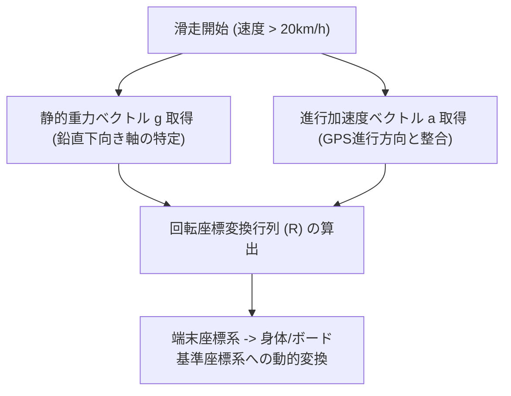
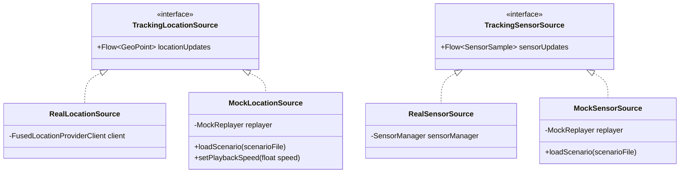

# 端末収納位置の前提定義 & モック再生（デバッグ機能）仕様書

---

## 1. 端末収納位置（ポケット）の前提定義 & キャリブレーション仕様

スマホの保持位置によってセンサーの動き（慣性力・傾き）が全く異なるため、**「推奨位置の定義」**と**「ユーザー設定 ＋ 自動キャリブレーション」**の二重構造で対応します。

### 1.1 推奨収納位置と機能対応マトリクス

スノーボードの「エッジ角（ボードの角付け）」は膝・大腿部の動きに直結するため、**パンツのポケットを推奨**とします。

| 収納位置 | エッジ角解析 | トリック判定 (ジャンプ/スピン) | 速度・高度・リフト判定 | 推奨度 |
| :--- | :---: | :---: | :---: | :---: |
| **パンツのポケット (前足側)** | **◎ 高精度** (ボード連動) | **◎ 判定可能** | **◎ 完全対応** | ★★★ **推奨 (デフォルト)** |
| **パンツのポケット (後足側)** | **○ 良好** | **○ 判定可能** | **◎ 完全対応** | ★★☆ |
| **ジャケットの胸ポケット** | △ (体幹傾きとして推定) | △ (ジャンプ滞空時間のみ) | **◎ 完全対応** | ★☆☆ |
| **バックパック / ヒップバッグ** | × (無効化) | × (無効化) | **◎ 完全対応** | 速度・リフトログのみ |

---

### 1.2 設定画面（ライディング・ギア設定）仕様

スマホの収納位置やスタンスは、**設定画面からいつでも何度でも変更可能**とします。

- **設定項目**:
  1. **スタンス**:
     - `Regular`（レギュラー: 左足前） / `Goofy`（グーフィー: 右足前）
     - ※ワンタップでトグル切り替え可能
  2. **スマホの収納位置**:
     - `パンツのポケット (前足側)`【推奨】
     - `パンツのポケット (後足側)`
     - `ジャケットの胸ポケット (内/外)`
     - `バックパック / ヒップバッグ`
     - `その他 (フリー)`
- **変更の適用タイミング**:
  - **通常設定**: 設定画面で変更した内容はローカル（DataStore / SharedPreferences）に即時保存され、以降のすべての滑走計測にデフォルト適用。
  - **滑走中・計測前のクイック変更**: 計測画面（一時停止時）のギアアイコンから、服を着替えたりポケットを変えた際に即座に1タップで切り替え可能。
  - 変更が検知された場合、姿勢キャリブレーション（姿勢アライメント）が自動で再計算されます。

---

### 1.3 直進滑走による自動姿勢キャリブレーション（姿勢アライメント）

ポケットの中でスマホが斜めに入っていても、滑走開始時の運動から**「進行方向」と「鉛直方向（重力）」を自動算出**して座標系を補正します。



- **アルゴリズム**:
  1. 重力センサー（ローパスフィルタ）で「下（重力方向）」のベクトルを特定。
  2. 直進滑走中（GPS速度が上昇しており、角速度が安定している区間）の加速度から「前（進行方向）」のベクトルを特定。
  3. この2軸からクォータニオン（回転行列）を生成し、スマホの傾きに関わらず「左右の傾き＝ロール角（エッジ角）」として算出。

---

## 2. テスト用モックデータ再生（デバッグ機能）設計

ゲレンデに行かなくても、Android Studioのエミュレータや実機上で**「滑走ログの完全再現・アルゴリズム検証」**を可能にするアーキテクチャを導入します。

### 2.1 センサー/GPSソースの抽象化（DI構成）



- **Debug Build限定**:
  - リリース版では本物のセンサー（`RealLocationSource` / `RealSensorSource`）のみをバンドル。
  - デバッグビルド時のみ、モック再生機能（`MockSource`）へワンタップで切り替え可能。

---

### 2.2 テスト用シナリオ（プリセットデータ）

開発・単体テスト用に以下の典型的なシナリオデータ（JSON/CSV）をプロジェクト内にアセットとして保持します。

1. **`scenario_normal_run.csv`**:
   - リフト降り場から滑走開始 → カービングターン数回 → 緩斜面で停止（速度・高度が緩やかに下降）。
2. **`scenario_lift_ride.csv`**:
   - 速度が 8〜15km/h で一定、高度が毎秒 0.8m ずつ上昇（リフト乗車検知の検証用）。
3. **`scenario_park_tricks.csv`**:
   - キッカーでのオーリー（低G → 着地衝撃）および 180 / 360 スピン時の高周波ジャイロデータ。
4. **`scenario_gondola_gps_loss.csv`**:
   - 途中でGPS受信が0件（ロスト）になり、数分後に山頂で復帰するケース。

---

### 2.3 アプリ内デバッグコントローラー（Overlay UI）

デバッグビルド時、画面隅のフローティングボタンをタップすると簡易シミュレータコントローラーを表示します。

```
+------------------------------------------------+
| [DEBUG CONTROLLER]                         [X] |
| Scenario: [ scenario_normal_run.csv      ▼ ]   |
|                                                |
|  [▶ 再生]   [⏸ 一時停止]   [倍速: 1x / 2x / 5x] |
|  Progress: [========--------] 01:24 / 03:00    |
|                                                |
| Current State: [ SKIING ] (自動判定結果)        |
| Speed: 42.1 km/h  |  Alt: 1,420m               |
|                                                |
| [クイックイベント発火]:                          |
|  [Ollieトリガー]  [転倒トリガー]  [GPSロスト]   |
+------------------------------------------------+
```

### 2.4 実機データレコーダー（ゲレンデ現場用ツール）
実際に雪山へテストに行った際、アルゴリズム開発用の教師データを収集するため、
- **ワンタップで生データ（GPS 1Hz + 加速度/ジャイロ 100Hz）をCSVファイルに保存するレコーダー機能**をデバッグメニュー内に組み込みます。
- 持ち帰ったCSVを上記のシミュレータに食わせることで、バグ修正や精度向上のPDCAを高速化します。
