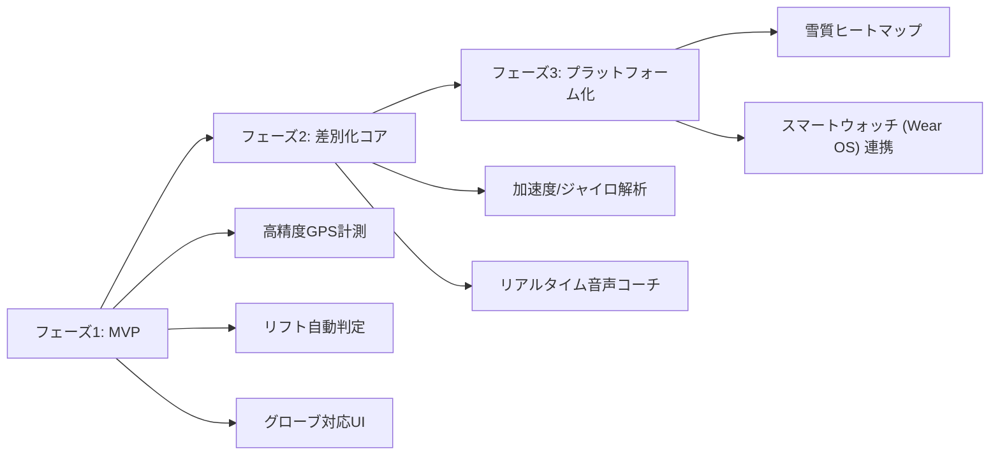

# スノーボード向けAndroidアプリ 要件定義書

## 1. プロジェクト概要
- **アプリ名（仮称）**: SnowPulse（スノープルス）
- **対象プラットフォーム**: Android（API Level 26 / Android 8.0以上、推奨: Android 12以上）
- **ターゲットユーザー**: 
  - 初中級者〜上級者のスノーボーダー（カービング上達、グラトリ・キッカー練習者など）
  - 数値で滑走の質を向上させたいデータ志向のスノーボーダー

---

## 2. コア機能要件（滑走数値データ取得）

スマートフォンのGPSおよび気圧・モーションセンサーを用いて、滑走中の各種ログを自動記録する。

| 項目 | 取得データ・仕様 | 精度・利用技術 |
| :--- | :--- | :--- |
| **距離・速度** | 最高速度、平均速度、総滑走距離、滑走時間 | GPS / GNSS |
| **高度・傾斜** | 獲得高度、滑走開始/終了標高、最大/平均斜度 | 気圧センサー + GPS + 地形データ |
| **リフト/滑走判定** | 滑走中とリフト搭乗中を自動判別し、滑走時のみ計測 | 速度・高度変化・移動パターンの判定ロジック |
| **オフライン動作** | ゲレンデの電波圏外でもローカルDB（SQLite/Room）に記録し、通信回復時に同期 | オフラインキャッシュ設計 |

---

## 3. ユニーク機能要件（yukiyama等との差別化機能）

yukiyamaなどの既存アプリは「マップ・位置共有・コミュニティ・基本GPSログ」が中心ですが、本アプリでは**「滑走技術の向上」「リアルタイム体験」「路面情報の自動化」**に特化した差別化を行います。

### 3.1 3Dモーション解析＆トリック自動検知（AI/IMUセンサー活用）
スマホ内蔵の6軸センサー（加速度＋ジャイロ）を活用し、ボードや身体の動きを解析。
- **トリック自動判別**:
  - オーリー/ノーリーの高さ・踏切タイミングのスコア化
  - スピン（180, 360等）の回転角度・着地成功判定
- **カービング角 / エッジング解析**:
  - ターン時のボードの傾き（バンク角/リーン角）
  - ターン切り替えの素早さ、Gフォース（遠心力）の推移可視化

### 3.2 リアルタイム音声フィードバック（スマートコーチング）
ポケットからスマホを取り出さず、Bluetoothイヤホン越しに滑走状態を耳元に伝達。
- **滑走中アラート**: 設定した最高速度超過時、トリック成功時の即時コール（「360 Success! 滞空0.8秒」など）。
- **ターンテンポガイド**: メトロノーム音やリズムで、ショートターンやカービングのリズムをガイド。
- **リフト搭乗時の自動サマリー**: リフトに乗った瞬間に「今の一本の最高速度: 58km/h、滑走時間: 1分40秒」と自動アナウンス。

### 3.3 振動解析による「雪質・バーン状況」クラウドヒートマップ
- **振動パターンから雪質を自動判定**:
  - ガタガタした振動（アイスバーン、荒れたバーン）
  - 滑らかな低周波振動（パウダースノー、圧雪バーン）
  - 重い抵抗（シャバ雪/湿雪）
- **集合知ヒートマップ**: 他のユーザーの滑走振動データと統合し、ゲレンデコースごとの「今の雪質・荒れ具合」をリアルタイムマップに表示。
---

## 4. ゲレンデ利用ライフサイクル（チェックイン / チェックアウト方式）

1回ごとの滑走開始・終了ボタン操作を不要とし、スキー場の1日滞在に合わせた自然なUXを提供する。

1. **到着時: スキー場チェックイン**
   - ゲレンデ到着時に「チェックイン」をタップしてスマホをポケットに収納。
   - バックグラウンドで待機・滑走・リフト搭乗を常時自動判別し、滑るたびにRun #1, Run #2 ... を自動分割して記録。
2. **滞在時: 休憩モード（一時停止機能）**
   - レストランでの昼食やロッジ休憩時、無駄なGPS・センサー消費や誤判定を防止するための「休憩する（一時停止）」ボタン。
   - 休憩中は計測を一時停止し、再開ボタンで即座に滑走計測へ復帰。
3. **帰宅時: スキー場チェックアウト**
   - 本日の全滑走終了時に「チェックアウト」をタップ。本日のトータルサマリー（総距離・本数・最高速・獲得標高・全ラン詳細）を確定保存。
4. **グローブ対応UI（ビッグボタン / スワイプ操作）**:
   - ゲレンデ上でグローブを装着したままでも誤操作しにくい大画面カードUI。
   - リアルタイム滑走メーター画面とゲレンデダッシュボードを自由に行き来可能。
   - 音量キー長押しでも一時停止/再開をトリガー可能。
5. **ラン分析ダッシュボード**:
   - 1本ごとの滑走ラインと速度・Gフォース・エッジ角のシンクロ再生（マップ上のポイントをタップするとその瞬間の傾きや速度を表示）。
6. **バッテリー残量・GPSステータス常時表示**:
   - 視認性の高いハイコントラストテーマ（雪上での反射対策）。

---

## 5. 技術選定（推奨スタック）

- **OS / 言語**: Android (Kotlin)
- **UIフレームワーク**: Jetpack Compose
- **バックグラウンド処理 / センサー取得**: 
  - `Foreground Service` (位置情報・センサーの常時バックグラウンド記録)
  - `Android SensorManager` (加速度計・ジャイロスコープ: 50Hz〜100Hzサンプリング)
  - `FusedLocationProviderClient` (高精度GPS)
- **ローカルストレージ**: Room Database (オフラインファースト設計)
- **音声読み上げ**: Android Text-to-Speech (TTS)
- **データ分析・AI**: TensorFlow Lite (トリック検知・雪質分類モデル)

---

## 6. 今後の検討事項（フェーズ分け）

