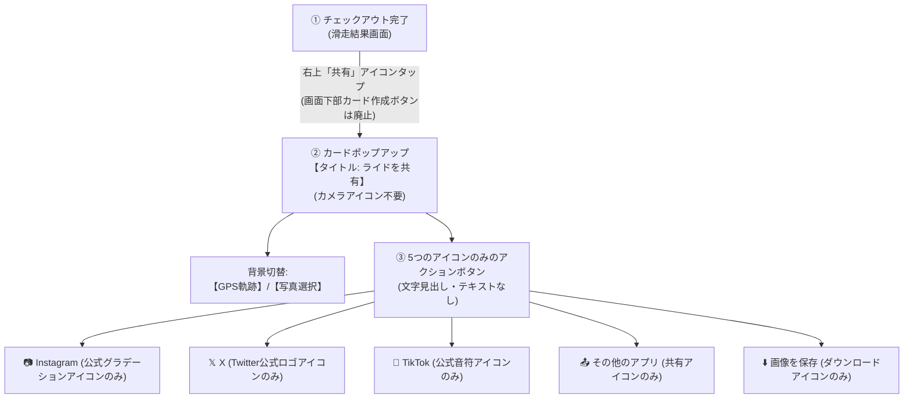

# SnowPulse「SNSシェア用リッチサマリーカード (1:1 スクエア特化)」要件定義書

---

## 1. 概要とフォーマット選定理由

### 1.1 採択フォーマット: 1:1 スクエア (1080 × 1080 px)
X（旧Twitter）および Instagram フィード投稿をターゲットとした、**1:1 正方形（1080×1080 px）のプレミアム滑走サマリーカード**を生成・共有する機能。

### 1.2 1:1 スクエアの選定メリット
1. **Xタイムラインでトリミングされない**: 縦長画像のような上下カットが発生せず、タイムライン上で1画面にすべての滑走成果（スキー場、GPS軌跡、最高速、エッジ角、AIスコア）が完璧に収まる。
2. **Instagramフィードの黄金比**: 正方形はフィードギャラリーで最も整然と美しく一覧化できる。
3. **視線の誘導がスムーズ**: 上部（ゲレンデ・日付）➔ 中央（ビジュアル・軌跡・AIバッジ）➔ 下部（4大滑走数値）の3段構造で一瞬で情報が伝わる。

---

## 2. 1:1 スクエアカードの画面構成＆デザイン仕様 (1080 × 1080 px)

```
+--------------------------------------------------------------+
| [❄️ 天気バッジ]    神立高原スキー場              2026/10/4 |  <- 上部ヘッダー (15%)
|                    AI SNOWBOARD TRACKER                      |
+--------------------------------------------------------------+
|                                                              |
|   [実測GPS軌跡 (ネオン発光S字ライン) / 撮影写真]              |
|                                                              |  <- 中央ビジュアル (50%)
|   [⭐ Ollie 180 (Air 0.65s)]     [⚡️ ディープ・カーバー]     |
|                                  [総合スコア: 88 (A+)]        |
+--------------------------------------------------------------+
|  最大エッジ角     最高速度        滑走距離 / 本数   獲得標高  |
|    52.8°        58.4 km/h       14.8 km / 8本     1,420 m   |  <- 下部メトリクス (30%)
|   (Deep Turn)  (平均 36.1km/h)                                |
+--------------------------------------------------------------+
|           POWERED BY SNOWPULSE  •  #SnowPulse                |  <- ブランドフッター (5%)
+--------------------------------------------------------------+
```

### 2.1 構成ブロック詳細

#### ① 上部ヘッダー (高さ 約160px)
- **左側**: 天気アイコン＆気温バッジ（例: `❄️ 粉雪 -3.5℃`）
- **中央〜左寄り**: スキー場名（例: **神立高原スキー場**、フォントサイズ 38px / Bold）
- **右側**: 滑走日付（例: `2026/10/4`）＋ SnowPulseロゴマーク

#### ② 中央ビジュアルエリア (高さ 約540px)
背景とオーバーレイのハイブリッド構成：
- **背景レイヤー**: 2パターンをタブでワンタップ切り替え可能
  - **Pattern A（軌跡グラフィック）**: 天候連動のダークトーン雪山背景 ＋ **実測GPS軌跡マップ（ネオンCyan〜Amberの美しいS字グラデーションライン、スタート/ゴールピン、トリック地点スターピン）**
  - **Pattern B（写真オーバーレイ）**: ユーザーが当日撮影した写真（端末ギャラリーから選択）に、滑走軌跡を半透明オーバーレイ
- **ビジュアル内フローティングバッジ**:
  - **右上**: AIライディングスタイルバッジ `⚡️ ディープ・カーバー` ＆ スコア `88 (A+)`
  - **左下または軌跡上**: ベストトリックバッジ `⭐ Ollie 180 (Air 0.65s)`（トリック検知時のみ）

#### ③ 下部メトリクスグリッド (高さ 約320px)
スノーボーダーが自慢したい4大数値を視認性抜群のグリッドカードで配置：
1. **最大エッジ角**: `52.8°`（アクセントカラー: オレンジ/ゴールド、ラベル: Deep Turn）
2. **最高速度**: `58.4 km/h`（アクセントカラー: ネオンシアン、サブ: 平均 36.1 km/h）
3. **滑走距離 / 本数**: `14.8 km / 8 Runs`
4. **獲得標高**: `1,420 m`（アクセントカラー: エメラルドグリーン）

#### ④ ブランドフッター (高さ 約60px)
- `POWERED BY SNOWPULSE • #SnowPulse`
- スノーボード愛好者のコミュニティハッシュタグを自然にアピール

---

## 3. UIフロー＆ユーザー体験（UX）



1. **トリガー導線**:
   - 滑走結果画面（`SessionResultScreen`）の**右上トップバーに配置された共有アイコン**（および wireframe.html の右上「共有」ボタン）をタップするとポップアップが開く。
   - 画面下部の重複していた「カード作成」ボタンは廃止され、「ダッシュボードに戻る」ボタンのみがすっきりと配置される。
2. **共有ダイアログ・ポップアップ**:
   - ダイアログタイトルは「**ライドを共有**」（カメラアイコン等の余分な装飾は撤廃）。
   - 「各SNSにシェア」等の不要な見出しテキストは削除し、カードプレビューを最大限アピール。
3. **5つのアイコンボタン（テキストなし・オリジナルアイコン使用・枠線/背景色統一）**:
   - **統一コンテナデザイン**: 5つすべてのボタンで背景色（ダークスレート `#1e293b`）、枠線（`1.5px solid #334155`）、角丸（`12px`）、サイズ（高さ `44〜46px`）、アイコン色（ホワイト `#ffffff`）を完全に統一し、整然とした上質なUIを実現。
   - **各オリジナルアイコン**:
     - **Instagram**: 公式カメラベクターアイコン
     - **𝕏 (X / Twitter)**: 公式 𝕏 ベクターロゴアイコン
     - **TikTok**: 公式 TikTok 音符ベクターロゴアイコン
     - **その他のアプリ**: 共有ベクターアイコン（LINE等の他アプリへのOS標準チューザー）
     - **画像を保存**: ダウンロードベクターアイコン（1080×1080px 高画質PNG端末保存）

---

## 4. 技術要件

### 4.1 Webプロトタイプ (`wireframe.html`)
- **HTML5 Canvas 描画エンジン**:
  - `canvas.width = 1080`, `canvas.height = 1080`
  - 背景画像（雪山グラフィックまたは選択写真）を描画
  - GPS軌跡（ベジェ曲線・グラデーションライン）をスケーリング描画
  - テキスト・数値・バッジアイコンを正確なピクセル座標でレンダリング
  - `canvas.toDataURL('image/png')` で即時ダウンロードまたはプレビュー表示

### 4.2 Androidネイティブ (`snowpulse-android`)
- **Jetpack Compose ➔ Bitmap キャプチャ**:
  - `rememberGraphicsLayer` または `drawToBitmap` を用いて、正方形の `ShareSummaryCardComposable`（1080dp相当の解像度）をオフスクリーン描画して `Bitmap` に変換。
- **Android共有インテント**:
  - `FileProvider` を経由してキャッシュ領域に画像を一時保存し、`Intent.ACTION_SEND`（`type = "image/png"`）を発行。
  - X（`com.twitter.android`）や Instagram（`com.instagram.android`）への直接Intent連携。

---

## 5. 実装ステップ計画

1. **ステップ1 (wireframe.html でのプロトタイプ実装)**:
   - 滑走結果画面に「📸 1:1 SNSカードを作成」ボタンを追加。
   - 1:1 スクエアカードのプレビューモーダルを実装。
   - HTML5 Canvas により、実際の滑走データ（スキー場名・日付・GPS軌跡・最高速・エッジ角・AIスタイル）を反映した 1080×1080px 画像のリアルタイム生成＆ダウンロード機能を実装。
123: 2. **ステップ2 (Android ネイティブ実装 & 共有権限)**:
124:    - Composeコンポーネント `ShareCardSquarePreview` を作成。
125:    - `generateShareCardBitmap` による 1080×1080px ビットマップ描画。
126:    - `AndroidManifest.xml` に `FileProvider` 及び `<queries>` を宣言、`res/xml/file_paths.xml` を定義。
127:    - `getCardImageUri` による多重フォールバック（FileProvider cacheDir → externalCacheDir → MediaStore）。
128:    - X: `Intent.ACTION_SEND`（`type = "image/png"`、`EXTRA_STREAM`、ハッシュタグ付き `EXTRA_TEXT`、`clipData`、`grantUriPermission`）。
129:    - Instagram: フィード（`EXTRA_STREAM`）およびストーリーズ（`ADD_TO_STORY` + `interactive_asset_uri`）の画像直接連携。
130: 3. **ステップ3 (自動テスト検証)**:
131:    - `run_algorithm_tests.py` に TC-57 および TC-58 を追加し、カード生成ロジック・数値マッピング・FileProvider定義・権限フォールバックの整合性を検証。
